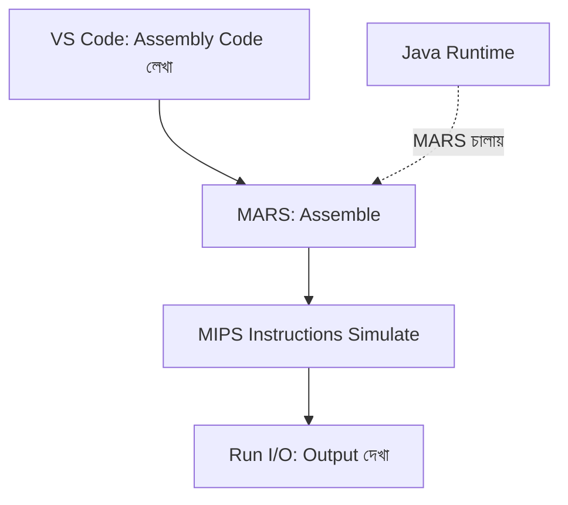
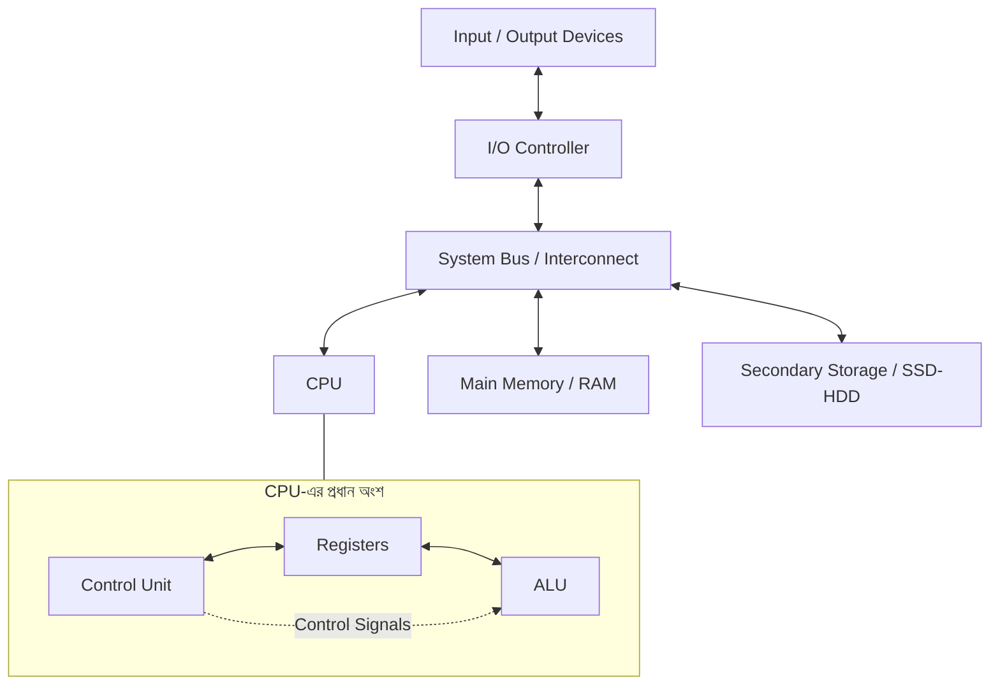

# Computer Architecture & MIPS Assembly
## Setup ও Lesson 01


---

## 1. Learning Setup

| Tool | কাজ |
|---|---|
| **VS Code** | Assembly Code লেখা ও সম্পাদনা |
| **Java JDK 21** | Java দিয়ে তৈরি MARS Application চালানো |
| **MARS 4.5** | MIPS Assembly Code Assemble ও Simulate করা |

### Tools-এর মধ্যে সম্পর্ক



**মনে রাখবে:** Java আমাদের MIPS Code-এর Compiler নয়। Java ইনস্টল করেছি MARS চালানোর জন্য। MARS একটি Simulator; এটি বাস্তব CPU-কে MIPS CPU-তে পরিবর্তন করে না।

### MARS চালানোর Command

```cmd
java -jar "C:\tools\MARS\Mars4_5.jar"
```

### VS Code থেকে Run

Project Root-এ `.vscode/tasks.json` তৈরি করে MARS-এর Command-Line Task Configure করা যায়। এরপর `.asm` ফাইল Save করে `Ctrl + Shift + B` চাপলে Program Run করা যায়।

> Command-Line পদ্ধতিতে MARS-এর Graphical Register Window দেখা যায় না। Register ও Memory পর্যবেক্ষণের জন্য MARS GUI ব্যবহার করব।

---

## 2. Lesson 01 — Computer Architecture-এর ভিত্তি

**Computer Architecture** হলো কম্পিউটারের প্রধান Component কীভাবে সংগঠিত থাকে এবং একসঙ্গে কাজ করে, তা বোঝার বিষয়।

### প্রধান Component

- **CPU (Central Processing Unit):** Instructions Execute করে।
- **Control Unit (CU):** Instruction Decode করে এবং প্রয়োজনীয় Control Signal দেয়।
- **ALU (Arithmetic Logic Unit):** Addition, Subtraction এবং Logical Operation করে।
- **Registers:** CPU-এর ভেতরের অল্পসংখ্যক ও দ্রুত Storage Location।
- **Main Memory (RAM):** চলমান Program ও Data রাখে।
- **Secondary Storage:** SSD/HDD-তে File ও Program দীর্ঘমেয়াদে সংরক্ষণ করে।
- **Input/Output (I/O):** Keyboard, Mouse, Display এবং অন্যান্য Device-এর সঙ্গে যোগাযোগে সাহায্য করে।
- **System Bus / Interconnect:** Component-গুলোর মধ্যে Data, Address ও Control Signal আদান-প্রদানে সাহায্য করে।

### Basic Computer Architecture Diagram



### Diagram-এর ব্যাখ্যা

- Control Unit Instruction অনুযায়ী কাজের ধাপ নিয়ন্ত্রণ করে।
- Registers অস্থায়ী মান ধরে রাখে।
- ALU Arithmetic ও Logical Operation করে।
- CPU চলমান Program-এর প্রয়োজন অনুযায়ী Main Memory থেকে Instruction ও Data ব্যবহার করে।
- Secondary Storage File দীর্ঘমেয়াদে রাখে।
- I/O Controller এবং System Interconnect-এর মাধ্যমে বিভিন্ন I/O Device-এর সঙ্গে যোগাযোগ হয়।

> এটি একটি সাধারণ ধারণামূলক Diagram। বাস্তব Computer-এর Architecture আরও জটিল হতে পারে।

---

## 3. Assembly Language ও MIPS

- **Assembly Language:** Processor Instruction-কে মানুষের পড়ার উপযোগী Mnemonic দিয়ে লেখার Low-Level Language।
- **ISA (Instruction Set Architecture):** Processor কোন Instruction বুঝবে এবং সেগুলোর নিয়ম কী হবে তা নির্ধারণ করে।
- **MIPS:** একটি Instruction Set Architecture, যার Instruction দিয়ে আমরা অনুশীলন করছি।
- **MARS:** MIPS Assembly Code Assemble ও Simulate করার Software।

### প্রথম MIPS Instruction

```asm
add $t0, $t1, $t2
```

অর্থ: `$t1` এবং `$t2` Register-এর মান যোগ করে ফলাফল `$t0` Register-এ রাখো।

উদাহরণ:

- `$t1 = 5`
- `$t2 = 3`
- Instruction Execute হওয়ার পর `$t0 = 8`

**Operand-এর ক্রম:** Destination, Source 1, Source 2।

---

## 4. প্রথম Program — Hello, MIPS!

**File:** `01_hello_mips.asm`

```asm
# Junayed Hasan
# Program: Print Hello, MIPS!

.data
message: .asciiz "Hello, MIPS!\n"

.text
.globl main

main:
    li $v0, 4          # Select print-string service
    la $a0, message    # Load message address
    syscall            # Print the string

    li $v0, 10         # Select exit service
    syscall            # Exit the program
```

### গুরুত্বপূর্ণ Instruction ও Directive

| Code | কাজ |
|---|---|
| `.data` | Data রাখার Section |
| `.asciiz` | Null-Terminated String সংরক্ষণ |
| `.text` | Instructions রাখার Section |
| `li $v0, 4` | MARS-এ Print-String Service নির্বাচন |
| `la $a0, message` | `message`-এর Address `$a0`-তে রাখা |
| `syscall` | নির্বাচিত Service Execute করা |
| `li $v0, 10` | MARS-এ Program Exit Service নির্বাচন |

### Expected Output

```text
Hello, MIPS!

-- program is finished running --
```

> `syscall`-এর Service Number-গুলো MARS-এর Educational Syscall Convention অনুযায়ী।

---

## 5. Lesson 01 — Quick Revision

- CPU Instructions Execute করে।
- Control Unit কাজের ধাপ নিয়ন্ত্রণ করে।
- ALU Arithmetic ও Logical Operation করে।
- Registers CPU-এর ভেতরে দ্রুত Storage Location।
- RAM চলমান Program ও Data রাখে।
- SSD/HDD দীর্ঘমেয়াদে File সংরক্ষণ করে।
- Java প্রয়োজন MARS চালানোর জন্য।
- MIPS Assembly Code Java Language-এ লেখা নয়।
- `add $t0, $t1, $t2` হলো `$t1 + $t2`-এর ফল `$t0`-তে রাখা।
- প্রথম Program সফলভাবে `Hello, MIPS!` Output দিয়েছে।
- **Lesson 01 Quiz Score: 3/3 (100%)**

---

## 6. Lesson শেষে Practice করার নিয়ম

প্রতিটি Lesson শেষে:

1. শেখা Concept ব্যবহার করে একটি ছোট Program নিজে লিখব।
2. MARS-এ Run করে Output যাচাই করব।
3. Code-এর গুরুত্বপূর্ণ Line-এ English Comment যোগ করব।
4. এই Note-এ Lesson-এর Summary, Practice Code এবং প্রয়োজনীয় Diagram যোগ করব।

### Next Lesson

**Lesson 02 — MIPS Registers**

- `$zero`
- `$t0–$t9`
- `$a0–$a3`
- `$v0–$v1`
- Register-এর মান পরিবর্তন ও পর্যবেক্ষণ
