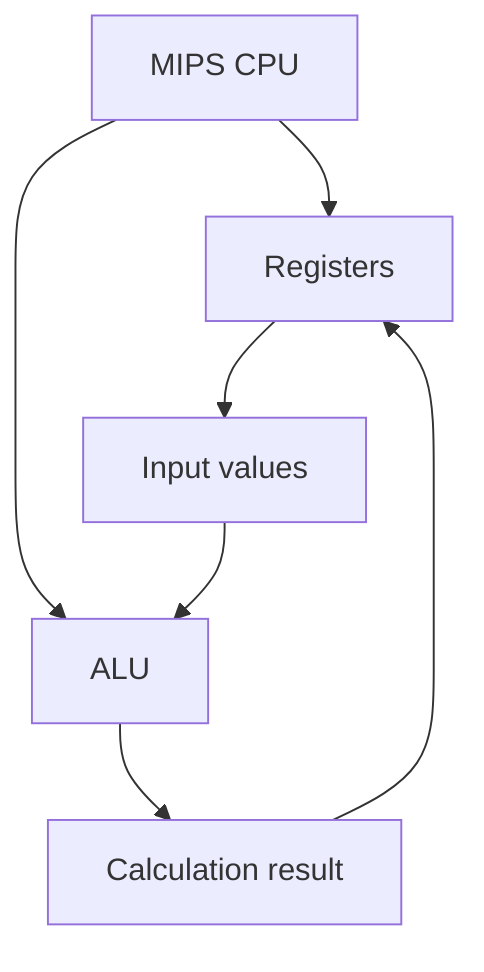

---

# Lesson 02: MIPS Registers

## 1. Register কী?

Register হলো CPU-এর ভেতরে থাকা ছোট ও দ্রুতগতির storage location। CPU হিসাব করার সময় প্রয়োজনীয় data এবং result register-এ রাখতে পারে।

MIPS-এর সাধারণ register 32-bit। অর্থাৎ প্রতিটি register-এ 32টি binary bit রাখা যায়।

### Register-এর ধারণাচিত্র



## 2. গুরুত্বপূর্ণ MIPS Registers

| Register | কাজ |
|---|---|
| `$zero` | সবসময় 0 রাখে |
| `$t0`–`$t9` | Temporary data রাখে |
| `$a0`–`$a3` | Arguments পাঠাতে ব্যবহৃত হয় |
| `$v0`–`$v1` | Return value রাখতে পারে; MARS-এ `$v0` দিয়ে syscall service নির্বাচন করা হয় |

## 3. `$zero` Register

`$zero`-এর মান সবসময় 0। এতে অন্য মান সংরক্ষণ করা যায় না।

```asm
add $t0, $zero, $zero
```

এখানে:

- `$zero`-এর মান 0।
- ALU হিসাব করে `0 + 0`।
- ফলাফল `$t0`-তে রাখা হয়।
- তাই `$t0 = 0`।

## 4. Temporary Registers দিয়ে যোগ

```asm
li $t0, 10
li $t1, 20
add $t2, $t0, $t1
```

ব্যাখ্যা:

- `li` একটি immediate value register-এ রাখে।
- `$t0`-তে 10 রাখা হয়।
- `$t1`-তে 20 রাখা হয়।
- `add` দুটি register-এর মান যোগ করে `$t2`-তে রাখে।

ফলাফল:

```text
$t0 = 10
$t1 = 20
$t2 = 30
```

### `add` Instruction-এর Format

```asm
add destination, source1, source2
```

উদাহরণ:

```asm
add $t2, $t0, $t1
```

এর অর্থ:

```text
$t2 = $t0 + $t1
```

## 5. `li`, `move` এবং `syscall`

| Instruction | কাজ |
|---|---|
| `li` | Register-এ immediate value রাখে |
| `move` | এক register-এর মান অন্য register-এ কপি করে |
| `syscall` | MARS-এ নির্বাচিত system service চালায় |

MARS-এর সাধারণ print service:

| `$v0`-এর মান | কাজ |
|---|---|
| `1` | Integer print |
| `4` | String print |
| `10` | Program exit |

Integer print করার উদাহরণ:

```asm
li $v0, 1
move $a0, $t2
syscall
```

এখানে `$v0 = 1` integer print service নির্বাচন করে এবং `$a0`-তে print করার integer দেওয়া হয়।

## 6. Practice Program: Add Two Numbers

File: `02_registers.asm`

```asm
# Junayed Hasan
# Program: Add two numbers using registers

.text
.globl main

main:
    li $t0, 10          # Store 10 in $t0
    li $t1, 20          # Store 20 in $t1

    add $t2, $t0, $t1   # Add both numbers

    li $v0, 1           # Select print-integer service
    move $a0, $t2       # Pass the result to $a0
    syscall             # Print the result

    li $v0, 10          # Select exit service
    syscall             # Exit the program
```

Expected output:

```text
30
```

### Register Values

| Register | Decimal value | Hexadecimal value |
|---|---:|---|
| `$t0` | 10 | `0x0000000A` |
| `$t1` | 20 | `0x00000014` |
| `$t2` | 30 | `0x0000001E` |

## 7. Quick Revision

- Register হলো CPU-এর ভেতরের দ্রুতগতির storage location।
- `$zero` সবসময় 0 দেয়।
- `$t0`–`$t9` temporary data রাখে।
- `$a0`–`$a3` arguments পাঠাতে ব্যবহৃত হয়।
- `$v0` MARS-এ syscall service নির্বাচন করতে পারে।
- `li` register-এ immediate value রাখে।
- `move` এক register থেকে অন্য register-এ মান কপি করে।
- `add` দুটি register-এর মান যোগ করে।

## Next Lesson

**Lesson 03: MIPS Arithmetic Instructions**

পরবর্তী lesson-এ `add`, `sub`, `addi`, `mult` এবং `div`-এর মতো arithmetic instructions ধাপে ধাপে শিখব।
