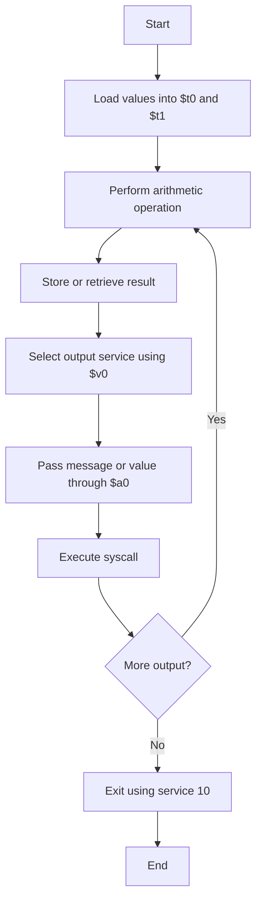

---

# Lesson 03: MIPS Arithmetic Instructions

## 1. Lesson Overview

এই lesson-এ আমরা MIPS Assembly ব্যবহার করে যোগ, বিয়োগ, সরাসরি সংখ্যা যোগ, গুণ এবং ভাগ করা শিখেছি।

## 2. Arithmetic Instructions

| Instruction | কাজ | উদাহরণ |
|---|---|---|
| `add` | দুটি register-এর মান যোগ করে | `add $t2, $t0, $t1` |
| `sub` | দুটি register-এর মান বিয়োগ করে | `sub $t2, $t0, $t1` |
| `addi` | register-এর সঙ্গে সরাসরি সংখ্যা যোগ করে | `addi $t2, $t0, 3` |
| `mult` | দুটি register-এর মান গুণ করে | `mult $t0, $t1` |
| `div` | দুটি register-এর মান ভাগ করে | `div $t0, $t1` |
| `mflo` | `LO` register-এর মান কপি করে | `mflo $t2` |
| `mfhi` | `HI` register-এর মান কপি করে | `mfhi $t3` |

## 3. Addition, Subtraction and Add Immediate

### Addition

```asm
li  $t0, 20
li  $t1, 5
add $t2, $t0, $t1   # $t2 = 20 + 5 = 25
```

`add` দুটি source register-এর মান যোগ করে destination register-এ রাখে।

### Subtraction

```asm
li  $t0, 20
li  $t1, 5
sub $t2, $t0, $t1   # $t2 = 20 - 5 = 15
```

`sub` প্রথম source register থেকে দ্বিতীয় source register-এর মান বিয়োগ করে।

### Add Immediate

```asm
li   $t0, 20
addi $t2, $t0, 3    # $t2 = 20 + 3 = 23
```

`addi` একটি register-এর সঙ্গে instruction-এ সরাসরি লেখা সংখ্যাটি যোগ করে।

**মনে রাখবে:**

- `add` = Register + Register
- `addi` = Register + Immediate value
- `sub` = Register − Register

## 4. Multiplication: `mult`, `mflo`

```asm
li   $t0, 20
li   $t1, 5

mult $t0, $t1       # Multiply 20 by 5; result goes into HI and LO
mflo $t2            # Copy the lower 32 bits from LO into $t2
```

MIPS-এর `mult` instruction গুণফল `HI` ও `LO` নামের দুটি special register-এ রাখে।

- `LO` ধারণ করে গুণফলের নিচের 32 bits।
- `HI` ধারণ করে গুণফলের উপরের 32 bits।
- `mflo` দিয়ে `LO`-এর মান সাধারণ register-এ কপি করা যায়।
- `mfhi` দিয়ে `HI`-এর মান সাধারণ register-এ কপি করা যায়।

এই উদাহরণে গুণফল 100, তাই `$t2 = 100`।

## 5. Division: `div`, `mflo`, `mfhi`

```asm
li   $t0, 27
li   $t1, 4

div  $t0, $t1       # Divide 27 by 4
mflo $t2            # Copy quotient into $t2
mfhi $t3            # Copy remainder into $t3
```

সাধারণ MIPS integer division-এ:

- `LO`-তে Quotient বা ভাগফল থাকে।
- `HI`-তে Remainder বা ভাগশেষ থাকে।

ফলাফল:

| Register | মান | অর্থ |
|---|---:|---|
| `$t2` | 6 | Quotient |
| `$t3` | 3 | Remainder |

কারণ:

\[
27 = (4 \times 6) + 3
\]

### Division Formula

\[
\text{Dividend} =
(\text{Divisor} \times \text{Quotient}) + \text{Remainder}
\]

শূন্য দিয়ে ভাগ করা যাবে না। `div`-এর divisor শূন্য হলে ফলাফল নির্ভরযোগ্য নয়।

## 6. MARS System Calls

MARS-এ `syscall` ব্যবহার করে output দেখানো এবং program বন্ধ করার মতো কাজ করা যায়।

| `$v0` value | কাজ |
|---:|---|
| `1` | Integer print |
| `4` | String print |
| `10` | Program exit |

### String Print

```asm
li $v0, 4        # Select print-string service
la $a0, sumMsg   # Load the address of the string into $a0
syscall          # Print the string
```

- `li` register-এ একটি immediate value রাখে।
- `$v0 = 4` string print service নির্বাচন করে।
- `la` string-এর address `$a0`-তে রাখে।
- `syscall` নির্বাচিত service চালায়।

### Integer Print

```asm
li   $v0, 1      # Select print-integer service
move $a0, $t2    # Copy the integer value into $a0
syscall          # Print the integer
```

এখানে `$a0`-তে integer-এর value দেওয়া হয়।

**পার্থক্য:**

- `la` = address load করে।
- `move` = register-এর value কপি করে।

### Program Exit

```asm
li $v0, 10       # Select exit service
syscall          # End the program
```

## 7. Message Labels and `.asciiz`

```asm
.data
sumMsg: .asciiz "Sum: "
```

- `.data` হলো data রাখার section।
- `sumMsg` হলো programmer-এর দেওয়া label।
- `.asciiz` string-টি memory-তে রাখে এবং শেষে null terminator যোগ করে।
- `"Sum: "` হলো output-এ দেখানোর text।

Label নিজে output-এ দেখা যায় না। `la $a0, sumMsg` দিয়ে তার address পাঠিয়ে print করতে হয়।

### Newline

```asm
subMsg: .asciiz "\nSubtraction: "
```

`\n` নতুন লাইন শুরু করে।

## 8. Arithmetic Program Flowchart



## 9. Complete Practice Program

File: `03_arithmetic.asm`

```asm
# Junayed Hasan
# Program: MIPS Arithmetic Operations

.data
sumMsg:  .asciiz "Sum: "
subMsg:  .asciiz "\nSubtraction: "
addiMsg: .asciiz "\nAddi: "
multMsg: .asciiz "\nMultiplication: "
divMsg:  .asciiz "\nDivision quotient: "
remMsg:  .asciiz "\nDivision remainder: "

.text
.globl main

main:
    li $t0, 20
    li $t1, 5

    # Addition
    add $t2, $t0, $t1

    li $v0, 4
    la $a0, sumMsg
    syscall

    li $v0, 1
    move $a0, $t2
    syscall

    # Subtraction
    sub $t2, $t0, $t1

    li $v0, 4
    la $a0, subMsg
    syscall

    li $v0, 1
    move $a0, $t2
    syscall

    # Add immediate
    addi $t2, $t0, 3

    li $v0, 4
    la $a0, addiMsg
    syscall

    li $v0, 1
    move $a0, $t2
    syscall

    # Multiplication
    mult $t0, $t1
    mflo $t2

    li $v0, 4
    la $a0, multMsg
    syscall

    li $v0, 1
    move $a0, $t2
    syscall

    # Division
    div $t0, $t1
    mflo $t2
    mfhi $t3

    li $v0, 4
    la $a0, divMsg
    syscall

    li $v0, 1
    move $a0, $t2
    syscall

    li $v0, 4
    la $a0, remMsg
    syscall

    li $v0, 1
    move $a0, $t3
    syscall

    # Exit
    li $v0, 10
    syscall
```

### Expected Output

```text
Sum: 25
Subtraction: 15
Addi: 23
Multiplication: 100
Division quotient: 4
Division remainder: 0
```

## 10. Lesson 03 Quick Revision

- `add`, `sub` ও `addi` arithmetic operations-এর জন্য ব্যবহৃত হয়।
- `mult` গুণফল `HI` ও `LO`-তে রাখে।
- `div` quotient `LO`-তে এবং remainder `HI`-তে রাখে।
- `mflo` ও `mfhi` special register থেকে value কপি করে।
- `$v0` MARS-এ system service নির্বাচন করে।
- `$a0` system service-এর argument দিতে ব্যবহৃত হয়।
- `syscall` নির্বাচিত service চালায়।
- `.data` data section এবং `.text` instruction section।
- `.asciiz` string-এর শেষে null terminator যোগ করে।

## 11. Practice Result

পরীক্ষিত values:

```text
$t0 = 27
$t1 = 4
```

| Operation | Result |
|---|---:|
| Sum | 31 |
| Subtraction | 23 |
| Multiplication | 108 |
| Division Quotient | 6 |
| Division Remainder | 3 |

## Next Lesson

**Lesson 04: Negative Numbers, Signed Values and Overflow Basics**
